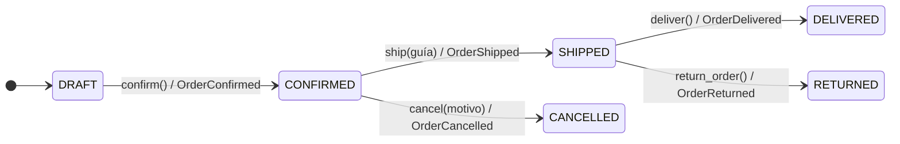
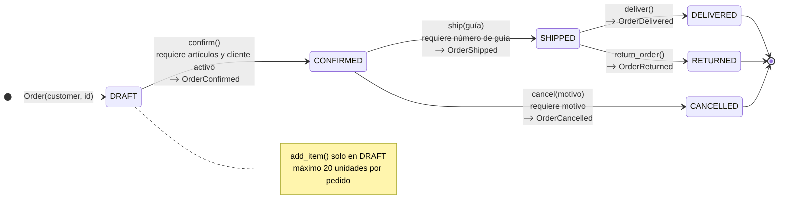
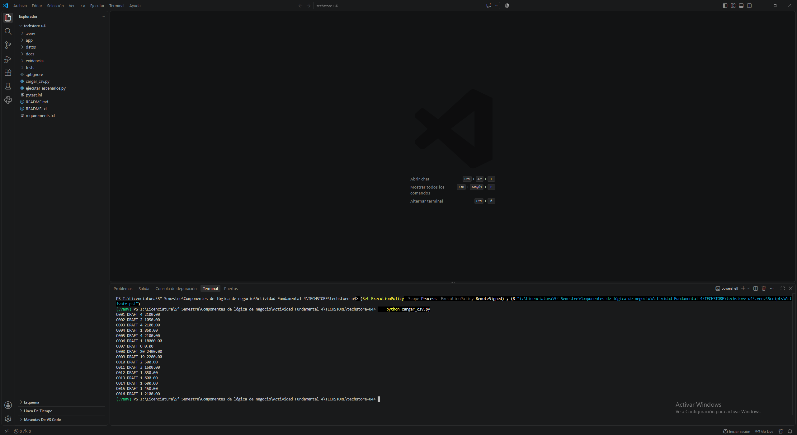
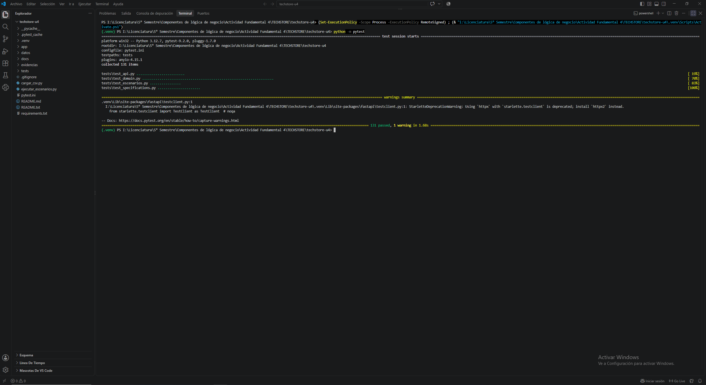
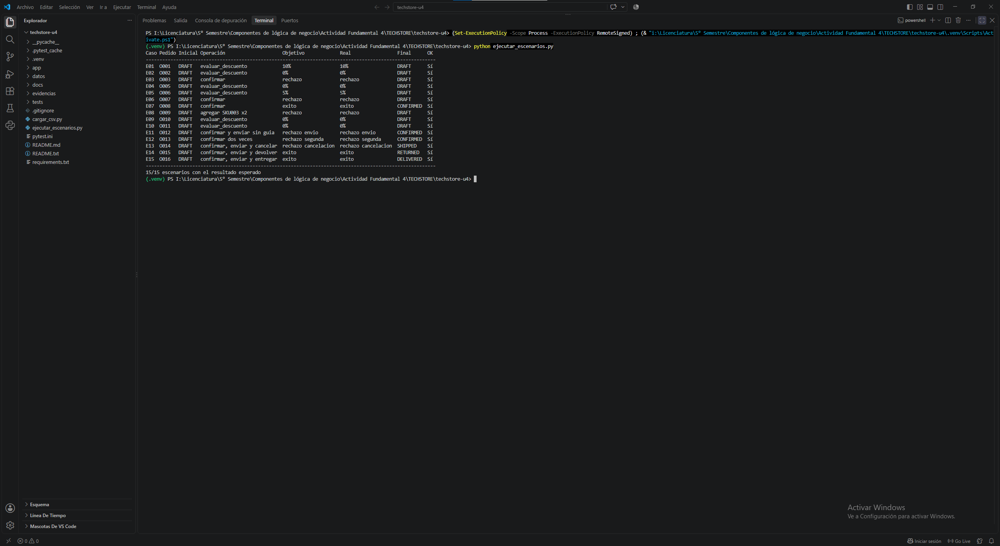
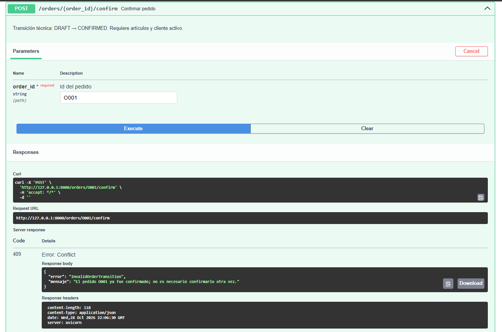

# TechStore U4 – Núcleo de negocio

**Componentes de Lógica de Negocio · Unidad 4 · FIME UANL**
Actividad 4: implementación del núcleo de negocio (entidades DDD, Specification Pattern, máquina de estados, Domain Events y API REST).

| Dato | Información |
|---|---|
| Materia | Componentes de Lógica de Negocio |
| Profesor | Miguel Ángel Gómez Marroquín |
| Equipo | 6 |

| Integrante | Matrícula |
|---|---|
| Jesus Eduardo Moreno Osoria | 2136063 |
| Osvaldo Salvador Cárdenas Mejorado | 2141553 |
| Abraham Sandoval De León | 2136604 |

---

## ¿Qué hace?

Administra los pedidos de la tienda ficticia TechStore:

1. Lee clientes, productos y pedidos de `datos/*.csv` y los convierte en objetos del dominio (`cargar_csv.py`, entregado por el profesor, **sin modificar**).
2. Protege las reglas del negocio dentro de las clases (`Money`, `OrderItem`, `Customer`, `Order`).
3. Evalúa descuentos con **Specification Pattern** (AND `&`, OR `|`, NOT `~`).
4. Controla el ciclo de vida del pedido con una **máquina de estados** que registra **Domain Events**.
5. Expone los casos de uso con una **API REST (FastAPI)** que traduce las excepciones de dominio a **404 / 409 / 422**.
6. Responde al cliente con **mensajes amigables** en español: nunca muestra códigos internos como `DRAFT` o `CONFIRMED`.

Todo trabaja **en memoria**: no se necesita base de datos y al cerrar el programa los cambios se pierden.

## Estructura

```
techstore-u4/
├── datos/                     # 5 CSV del paquete del alumno
├── cargar_csv.py              # cargador del profesor (sin cambios)
├── ejecutar_escenarios.py     # corre E01–E15 y genera la bitácora
├── app/
│   ├── domain.py              # Money, OrderItem, Customer, Order, estados, eventos, excepciones
│   ├── specifications.py      # Specifications + DiscountService (10 % / 5 %)
│   ├── services.py            # Application Service (OrderService)
│   ├── infrastructure.py      # catálogo, repositorio en memoria, EventBus, EmailNotifier
│   ├── schemas.py             # DTOs de entrada/salida (Pydantic)
│   └── api.py                 # controladores FastAPI (delgados)
├── tests/                     # 131 pruebas pytest
│   ├── test_domain.py         # Value Objects, invariantes, todas las transiciones
│   ├── test_specifications.py # AND/OR/NOT, reglas atómicas y descuentos
│   ├── test_escenarios.py     # una prueba por escenario E01–E15
│   └── test_api.py            # códigos HTTP, mensajes amigables, eventos, OpenAPI
├── docs/                      # diagrama de estados, openapi.json, reporte
└── evidencias/                # capturas y bitácora generada
```

## Instalación

Requisitos: **Python 3.11 o superior**.

```bash
python --version
python -m venv .venv

# Windows PowerShell
.venv\Scripts\Activate.ps1
# Windows CMD
.venv\Scripts\activate.bat
# macOS / Linux
source .venv/bin/activate

python -m pip install -r requirements.txt
```

## Ejecución

```bash
# 1) Cargar los 16 pedidos (todos en DRAFT)
python cargar_csv.py

# 2) Ejecutar los 15 escenarios y generar evidencias/bitacora_escenarios.md
python ejecutar_escenarios.py

# 3) Pruebas automáticas
python -m pytest            # resumen
python -m pytest -v         # detalle de cada prueba

# 4) API REST
uvicorn app.api:app --reload
#   Swagger UI:        http://127.0.0.1:8000/docs
#   Contrato OpenAPI:  http://127.0.0.1:8000/openapi.json
```

> Entre pruebas manuales en Swagger usa `POST /admin/reset` (o reinicia el servidor) para volver al estado inicial.

## Reglas de negocio implementadas

| Regla | Dónde vive | Prueba que la demuestra |
|---|---|---|
| `Money` no admite montos negativos ni `float`; usa `Decimal` y es inmutable | `Money.__post_init__` | `TestMoney` |
| Cantidad de un artículo > 0 y SKU obligatorio | `OrderItem.__post_init__` | `test_cantidad_cero_o_negativa_se_rechaza` |
| Máximo **20 unidades** por pedido (suma de cantidades, no renglones) | `Order.add_item` | `test_unidad_21_lanza_excepcion_y_no_modifica_el_pedido`, E07, E08 |
| Solo se agregan artículos en `DRAFT` y en MXN | `Order.add_item` | `test_no_se_agregan_articulos_fuera_de_draft` |
| Confirmar requiere artículos y cliente activo | `Order.confirm` | E03, E06 |
| Enviar requiere número de guía | `Order.ship` | E11 |
| Cancelar requiere motivo y solo desde `CONFIRMED` | `Order.cancel` | E13, `test_cancelar_sin_motivo_falla` |
| Descuento **10 %**: VIP **y** total > 500 **y** ≥ 4 unidades **y NO** promoción | `vip_discount_spec()` | E01, E04, E09, E10 |
| Descuento **5 %**: total > 5000 **y NO** promoción | `high_amount_discount_spec()` | E05 |
| Elegibilidad = regla 10 % **OR** regla 5 %; si se cumplen ambas gana el 10 % | `DiscountService.evaluate` | `test_prioridad_10_cuando_cumple_ambas_reglas` |
| Una operación rechazada no cambia el estado ni registra eventos | `_ensure_can_move_to` + validar antes de cambiar | `test_toda_transicion_fuera_del_diagrama_se_rechaza_sin_efectos` (25 casos) |
| El estado y los artículos no se modifican desde fuera de `Order` | propiedades de solo lectura / tupla | `test_status_no_se_puede_asignar_desde_fuera` |

## Arquitectura

```
HTTP Request ─► DTO (schemas.py) ─► OrderService (services.py) ─► Order (domain.py)
                                         │                            │
                                         ├─ repositorio en memoria    └─ registra Domain Events
                                         └─ EventBus ─► EmailNotifier (suscriptor desacoplado)
HTTP Response ◄─ DTO ◄───────────────────┘
```

- El **controlador** (`api.py`) no contiene `if` de negocio: llama al servicio y devuelve un DTO.
- El **Application Service** obtiene el pedido, invoca el método de dominio, guarda y publica los eventos nuevos.
- El **dominio** no importa FastAPI ni lee archivos: se prueba en memoria y lo reutiliza también `ejecutar_escenarios.py` (una segunda interfaz, de consola).

## Máquina de estados





Cualquier salto que no aparece en el diagrama lanza `InvalidOrderTransition` (por ejemplo: cancelar desde `SHIPPED`, confirmar dos veces, entregar sin haber enviado). Las transiciones permitidas están en una sola tabla: `ALLOWED_TRANSITIONS` en `app/domain.py`.

## Domain Events

| Evento | Se registra cuando… | Datos | Suscriptores |
|---|---|---|---|
| `OrderConfirmed` | `DRAFT → CONFIRMED` | `order_id`, `customer_id`, `total`, `occurred_at` | `EmailNotifier`: «Hola Ana Torres: confirmamos tu pedido O001 por $2,100.00 MXN…» |
| `OrderShipped` | `CONFIRMED → SHIPPED` | `order_id`, `tracking_number`, `occurred_at` | `EmailNotifier`: aviso con número de guía |
| `OrderCancelled` | `CONFIRMED → CANCELLED` | `order_id`, `reason`, `occurred_at` | `EmailNotifier`: aviso con el motivo |
| `OrderDelivered` | `SHIPPED → DELIVERED` | `order_id`, `occurred_at` | `EmailNotifier`: aviso de entrega |
| `OrderReturned` | `SHIPPED → RETURNED` | `order_id`, `reason`, `occurred_at` | `EmailNotifier`: confirma la devolución |

Los eventos son inmutables (`@dataclass(frozen=True)`), con nombre en pasado y fecha en UTC. `Order` los acumula **solo después** de validar y cambiar el estado; el `OrderService` publica únicamente los eventos nuevos tras una operación exitosa. Si un suscriptor falla, el `EventBus` registra el error sin invalidar la operación.

## Endpoints

| Método | Ruta | Descripción | Códigos |
|---|---|---|---|
| GET | `/orders` | Lista los pedidos | 200 |
| POST | `/orders` | Crea un pedido vacío en DRAFT | 201, 404 |
| GET | `/orders/{id}` | Detalle: artículos, total, estado, eventos | 200, 404 |
| POST | `/orders/{id}/items` | Agrega `{sku, quantity}` | 200, 404, 409, 422 |
| POST | `/orders/{id}/confirm` | DRAFT → CONFIRMED | 200, 404, 409, 422 |
| POST | `/orders/{id}/ship` | Envía con `{tracking_number}` | 200, 404, 409, 422 |
| POST | `/orders/{id}/cancel` | Cancela con `{reason}` | 200, 404, 409, 422 |
| POST | `/orders/{id}/deliver` | SHIPPED → DELIVERED | 200, 404, 409 |
| POST | `/orders/{id}/return` | SHIPPED → RETURNED | 200, 404, 409 |
| GET | `/orders/{id}/discount` | Evalúa el descuento (10 % / 5 % / 0 %) | 200, 404 |
| GET | `/events` | Domain Events publicados | 200 |
| GET | `/notifications` | Correos simulados del `EmailNotifier` | 200 |
| POST | `/admin/reset` | Recarga los 16 pedidos del CSV | 200 |

Mapeo de excepciones (un solo lugar, `HTTP_STATUS_BY_ERROR` en `api.py`):

| Excepción | HTTP | Ejemplo |
|---|---|---|
| `NotFound` | 404 | `GET /orders/O999` |
| `InvalidOrderTransition` | 409 | confirmar dos veces O013 |
| `InvalidOrderData` | 422 | confirmar O007 (vacío) o O003 (cliente inactivo) |
| `OrderItemLimitExceeded` | 422 | agregar 2 × SKU003 a O009 (21 unidades) |

Respuesta de error: `{"error": "InvalidOrderTransition", "mensaje": "El pedido O013 ya fue confirmado; no es necesario confirmarlo otra vez."}`

- `error` es un código para programas (por ejemplo, la app que consume la API).
- `mensaje` es el texto que se le muestra al cliente.

## Mensajes amigables para el cliente

Los códigos `DRAFT`, `CONFIRMED`, `SHIPPED`, etc. son internos: sirven al programa, pero el cliente no tiene por qué conocerlos. Por eso:

| Situación | Lo que ve el cliente |
|---|---|
| Confirmar dos veces | El pedido O013 ya fue confirmado; no es necesario confirmarlo otra vez. |
| Cancelar un pedido enviado | No es posible cancelar el pedido O014 porque ya fue enviado. |
| Enviar sin confirmar | No es posible enviar el pedido O001 porque aún no ha sido confirmado. |
| Pedido vacío | El pedido O007 no tiene artículos. Agrega al menos un producto antes de confirmarlo. |
| Cliente inactivo | No es posible confirmar el pedido O003 porque la cuenta del cliente C003 está inactiva. Comunícate con atención a clientes. |
| Más de 20 piezas | Un pedido puede tener como máximo 20 piezas en total. El pedido O009 ya tiene 19 y se intentaron agregar 2; puedes agregar como máximo 1 más. |
| Falta la guía | Para enviar el pedido O012 es necesario capturar el número de guía de la paquetería. |
| Pedido inexistente | No encontramos el pedido O999. Verifica el número e intenta de nuevo. |
| Dato con formato incorrecto | Revisa la información enviada: 'quantity' debe ser un número entero. |

Además, cada pedido trae `status_label` («Pendiente de confirmar», «Confirmado», «Enviado», «Entregado», «Cancelado», «Devuelto»), cada evento trae una `description` («Pedido confirmado») y el descuento trae un `message` («¡Buenas noticias! Por ser cliente VIP… ahorras $210.00 MXN»). La prueba `test_mensajes_de_error_sin_codigos_internos` verifica que ningún mensaje de error contenga los códigos internos.

## Escenarios E01–E15

| Caso | Pedido | Operación | Esperado | Obtenido |
|---|---|---|---|---|
| E01 | O001 | evaluar descuento | 10 % | 10 % ✔ |
| E02 | O002 | evaluar descuento | 0 % | 0 % ✔ |
| E03 | O003 | confirmar | rechazo | `InvalidOrderData` (cliente inactivo) ✔ |
| E04 | O005 | evaluar descuento | 0 % | 0 % (promoción activa) ✔ |
| E05 | O006 | evaluar descuento | 5 % | 5 % ✔ |
| E06 | O007 | confirmar | rechazo | `InvalidOrderData` (sin artículos) ✔ |
| E07 | O008 | confirmar | éxito | CONFIRMED + `OrderConfirmed` ✔ |
| E08 | O009 | agregar SKU003 ×2 | rechazo | `OrderItemLimitExceeded` (21 u) ✔ |
| E09 | O010 | evaluar descuento | 0 % | 0 % (total = 500, no > 500) ✔ |
| E10 | O011 | evaluar descuento | 0 % | 0 % (solo 3 unidades) ✔ |
| E11 | O012 | confirmar y enviar sin guía | rechazo envío | sigue CONFIRMED ✔ |
| E12 | O013 | confirmar dos veces | rechazo segunda | `InvalidOrderTransition`, 1 solo evento ✔ |
| E13 | O014 | confirmar, enviar y cancelar | rechazo cancelación | sigue SHIPPED ✔ |
| E14 | O015 | confirmar, enviar y devolver | éxito | RETURNED ✔ |
| E15 | O016 | confirmar, enviar y entregar | éxito | DELIVERED ✔ |

Bitácora completa (precondiciones, eventos, explicación y prueba de cada caso): [`evidencias/bitacora_escenarios.md`](evidencias/bitacora_escenarios.md).

## Evidencias

| Evidencia | Archivo |
|---|---|
| Carga de los 16 pedidos | `evidencias/01_carga_16_pedidos.png` |
| Resultado de pytest (131 pruebas) | `evidencias/02_pytest_resultados.png`, `evidencias/03_pytest_escenarios_verbose.png` |
| Ejecución de los 15 escenarios | `evidencias/04_ejecutar_escenarios.png`, `evidencias/bitacora_escenarios.md` |
| Swagger `/docs` | `evidencias/05_swagger_docs.png` |
| Operación exitosa (200) | `evidencias/06_swagger_confirmar_200.png` |
| Operaciones rechazadas (409, 422 y 404) | `evidencias/07_swagger_confirmar_otra_vez_409.png`, `evidencias/08_swagger_pedido_vacio_422.png`, `evidencias/09_swagger_pedido_inexistente_404.png` |
| Contrato OpenAPI | `docs/openapi.json` |
| Diagrama de estados | `docs/diagrama_estados.png` |
| Reporte (bitácora, eventos, reflexión, preguntas) | `docs/REPORTE.md` y `docs/Reporte_Actividad4_TechStore_Equipo6.docx` |






## Notas

- El campo `existencia` de `productos.csv` es informativo: el laboratorio **no** descuenta inventario.
- En JSON los importes se devuelven como texto (`"2100.00"`) para no perder precisión decimal.
- Ninguna regla se cambió para que un escenario pasara; los pedidos se usan tal como vienen en el CSV.
